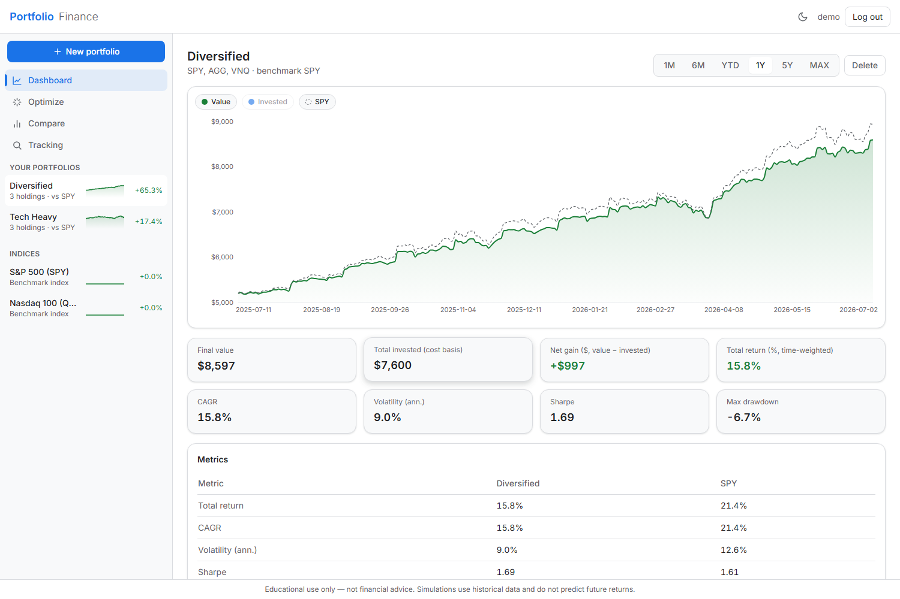
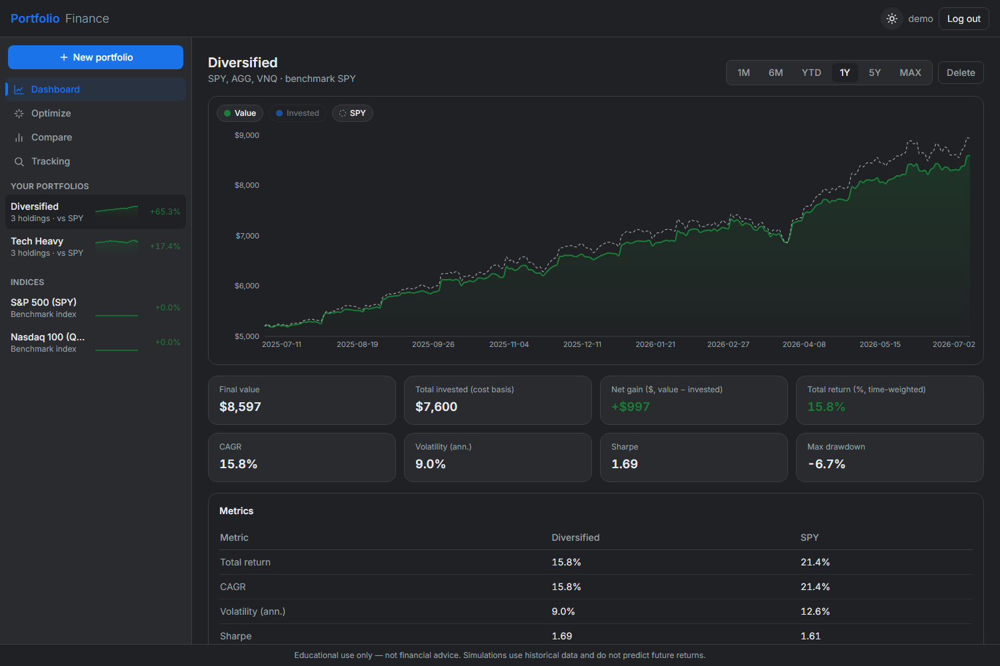
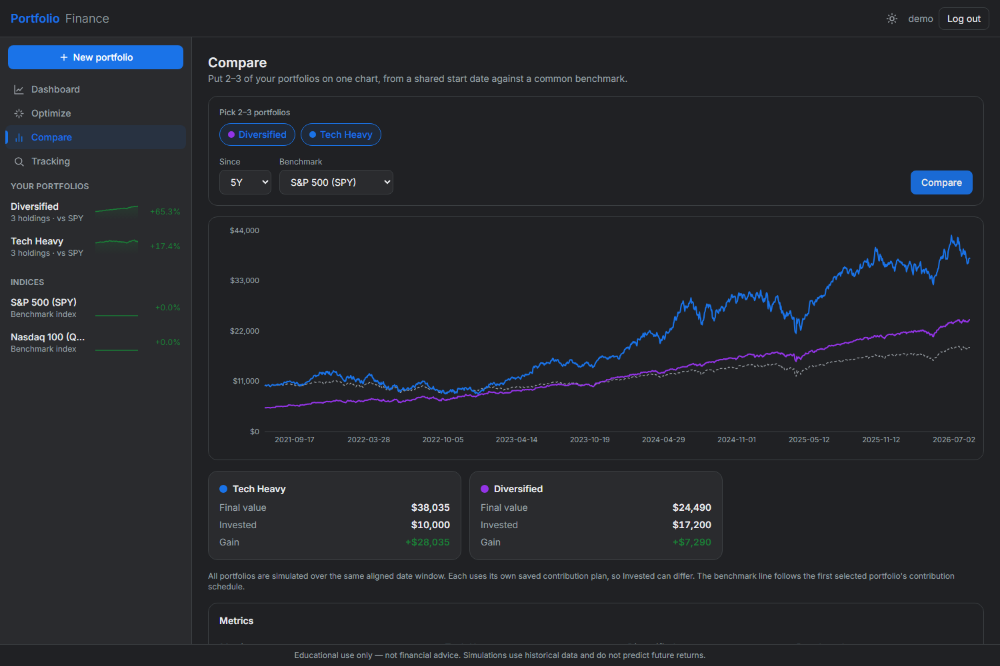
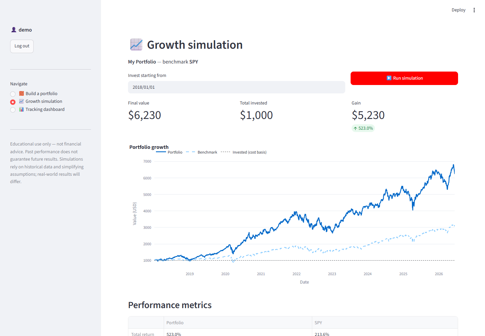
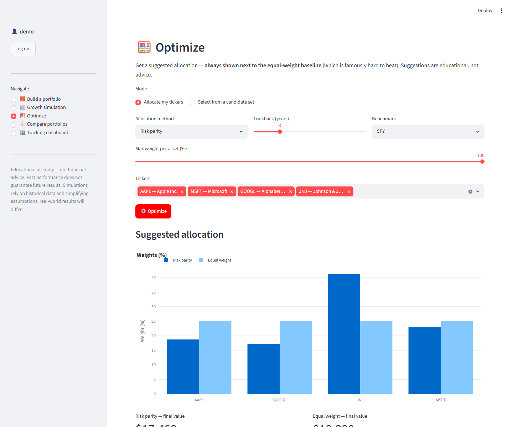
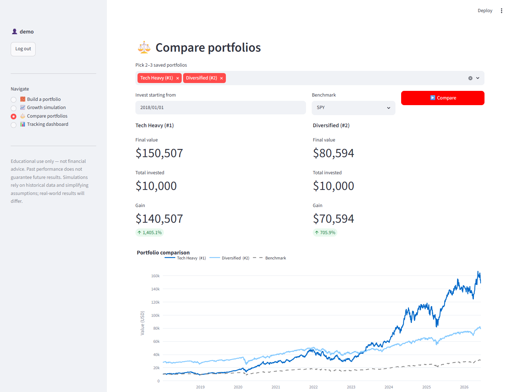
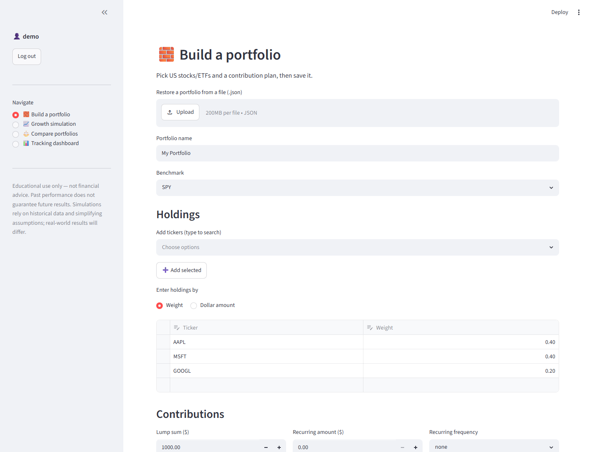

# portfolio-optimization-platform

A platform that simulates how money would have grown if invested in chosen US
stocks/ETFs from a chosen past date, lets multiple users save and track their own
portfolios daily vs a benchmark (each user sees only their own), and suggests
optimized long-term portfolios.

> **Educational use only — not financial advice.** Past performance does not
> guarantee future results. Simulations rely on historical data and simplifying
> assumptions; real-world results will differ.

## Tech stack

Python 3.11+ · [uv](https://docs.astral.sh/uv/) (env + packaging) · pandas/numpy ·
yfinance (prices) · SQLAlchemy + Alembic (SQLite now → PostgreSQL later) ·
Streamlit (UI now → FastAPI + React later) · matplotlib + Plotly.

## Two front ends

The platform has **two interchangeable UIs over the same `core/`** — isolated by
directory, both running independently:

- **Streamlit** (`app/`) — the original, fastest to iterate.
- **Web UI** (`api/` FastAPI + `web/` React) — a Google-Finance-style SPA with
  light/dark themes, green/red charts, Framer-Motion dynamics (skeleton loaders,
  count-ups, route transitions), a responsive mobile drawer, and Dashboard /
  Optimize / **Compare** / **Tracking** views. See [docs/WEB_UI.md](docs/WEB_UI.md).





## Project layout

```
data/     market-data fetching + parquet cache (yfinance wrapper)
core/     PURE finance/ML logic — no UI/DB imports (simulation, metrics, optimization)
storage/  SQLAlchemy models + user_id-scoped repository
app/      Streamlit UI (thin: calls core/ and storage/)
api/      FastAPI REST backend over core/ (JWT auth) — for the React web UI
web/      React + Vite + TS + Tailwind SPA (Google-Finance style)
jobs/     scheduled daily refresh (local now; CI cron later)
tests/    pytest
docs/     ARCHITECTURE, PLAN, PROGRESS, and design notes
```

See [docs/PLAN.md](docs/PLAN.md) for the phased build plan and
[docs/ARCHITECTURE.md](docs/ARCHITECTURE.md) for tooling rationale.

## Getting started

Requires [uv](https://docs.astral.sh/uv/getting-started/installation/).

```bash
# Install the locked environment
uv sync

# Copy the env template and adjust if needed (Phase 1 defaults to local SQLite)
cp .env.example .env        # PowerShell: Copy-Item .env.example .env

# Apply database migrations (creates portfolio.db locally)
uv run alembic upgrade head

# Run the test suite and linter
uv run pytest
uv run ruff check

# Launch the app
uv run streamlit run app/streamlit_app.py
```

Then sign up, build a portfolio on **Build a portfolio**, and run **Growth
simulation** to see how it would have grown vs the benchmark. Export a portfolio to
a JSON file to keep it on your computer, or save it to your account.

The daily tracking refresh runs locally:

```bash
uv run python -m jobs.refresh   # idempotent; upserts daily valuations
```

## Screenshots

Growth simulation — a 2018 lump sum in AAPL/MSFT/GOOGL vs the SPY benchmark
(dividend-adjusted, look-ahead-safe):



Optimize — suggested allocation (risk parity / HRP / inverse-vol / min-variance)
always shown next to the equal-weight baseline, with a growth comparison:



Compare 2–3 saved portfolios side by side (KPIs, one chart, a shared window for a
fair comparison):



Portfolio builder — searchable ticker suggestions, weight or $-amount entry,
benchmark picker, and a flexible contribution plan:



## Status

Phase 1 (local Streamlit + SQLite) is functional: multi-user login, portfolio
builder with file export/import + account save, dividend-adjusted growth simulation
vs a benchmark, and a tracking dashboard. See [docs/PROGRESS.md](docs/PROGRESS.md).
