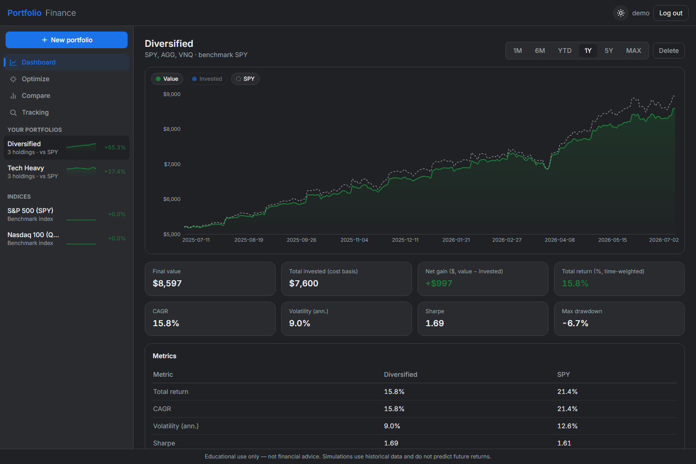
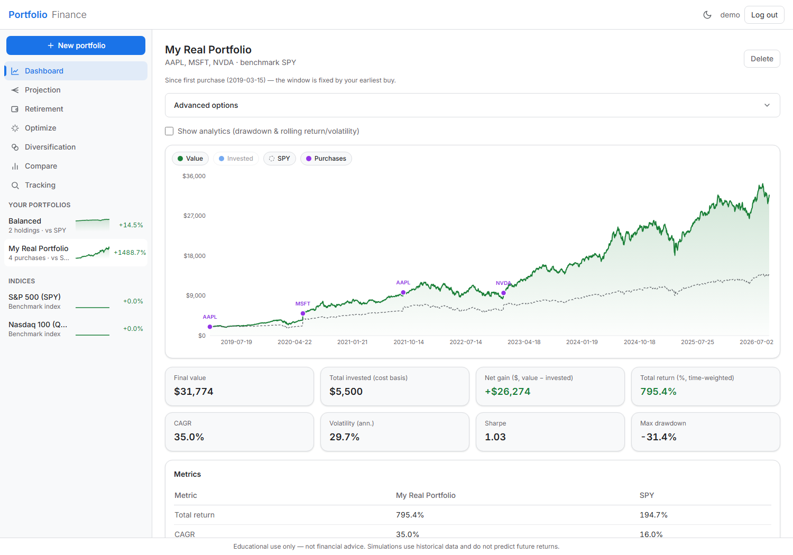
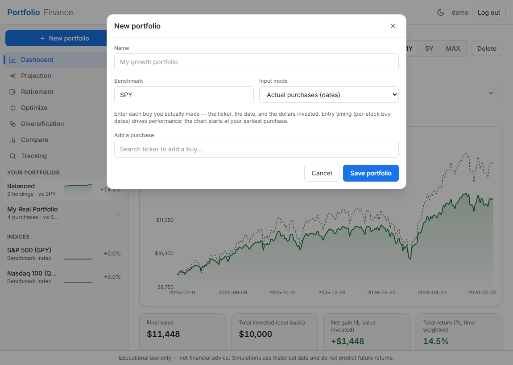
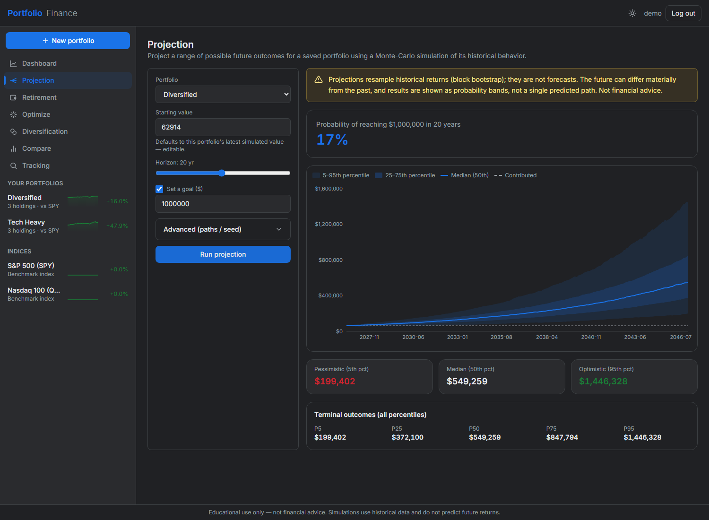
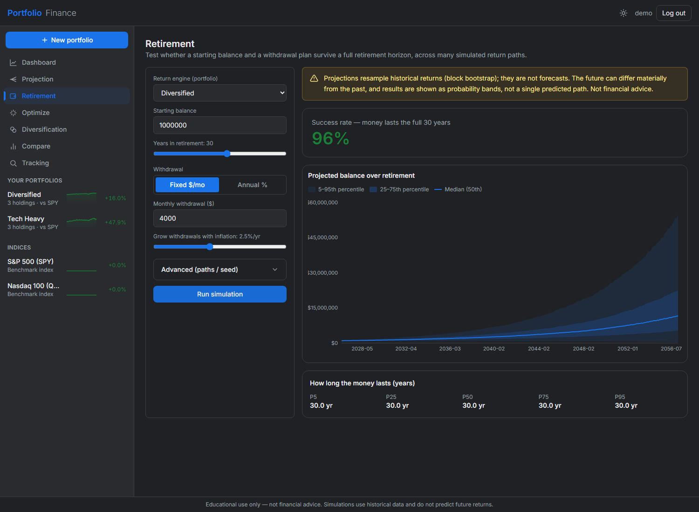
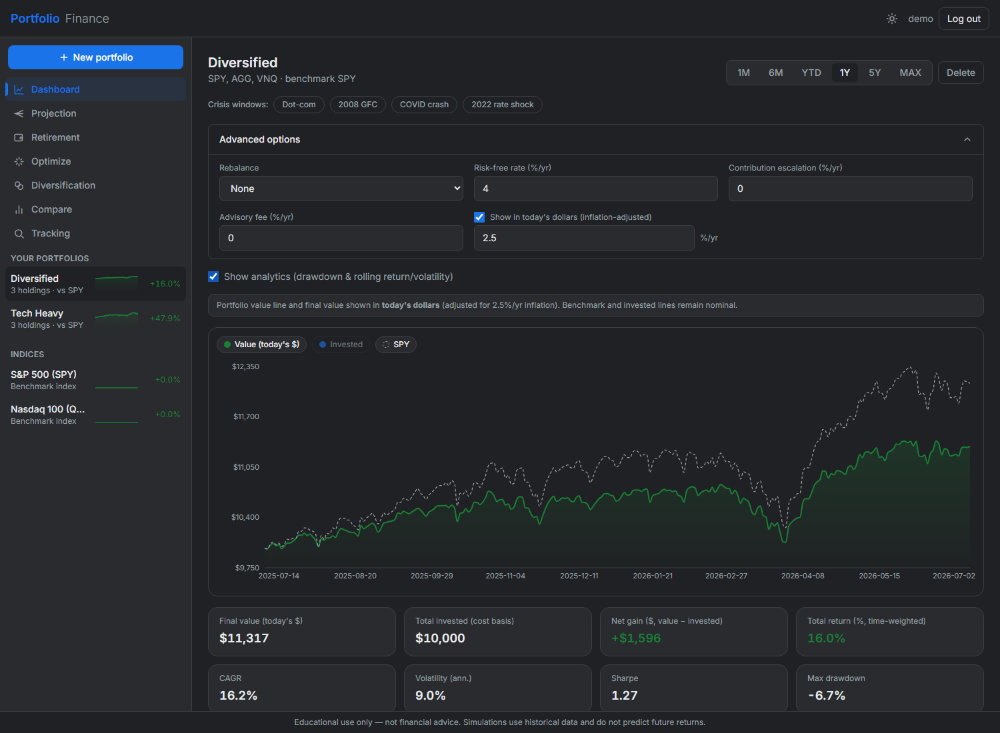
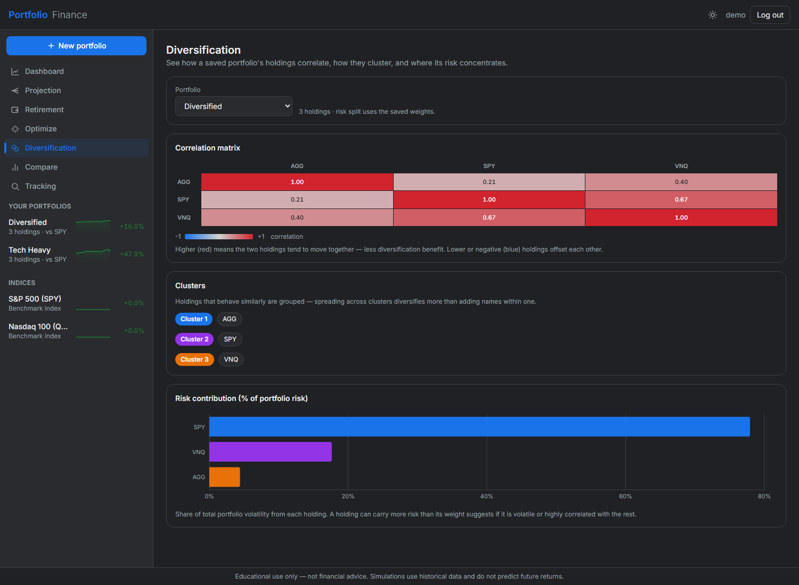
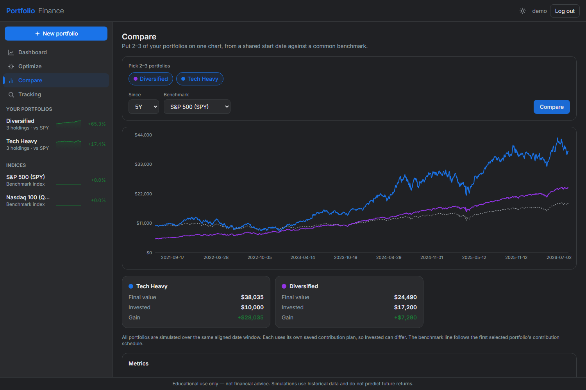
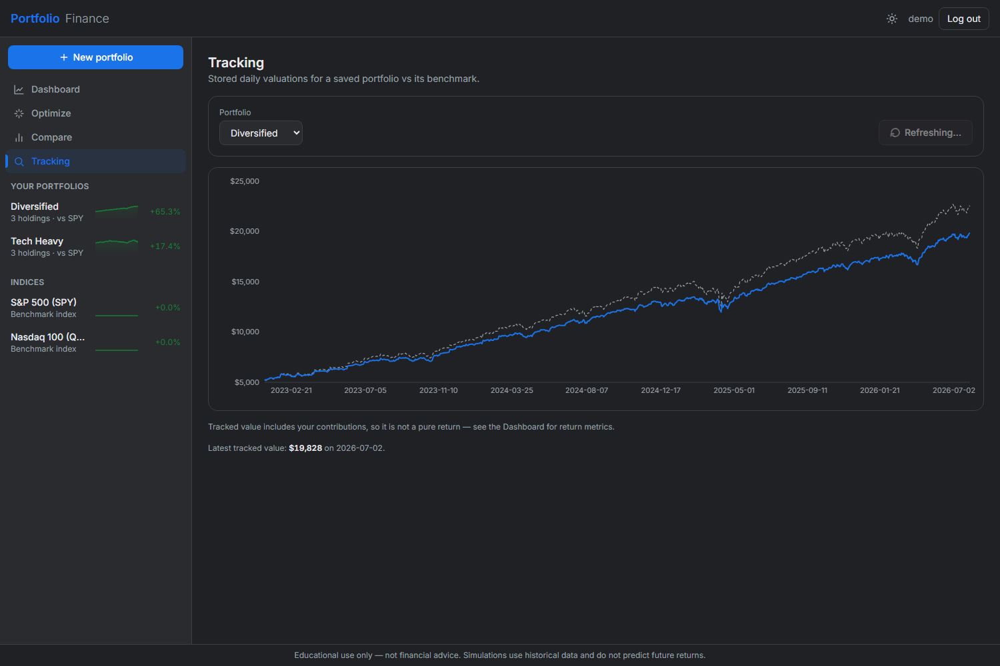
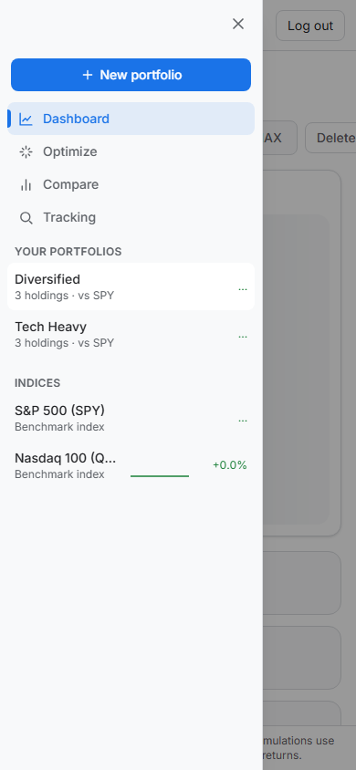

# Web UI — FastAPI + React (Google-Finance style)

A second, polished front end built **alongside** the Streamlit app (Phases 0–2),
inspired by Google Finance: a dark/light dashboard with green-for-up / red-for-down
charts. It pulls the planned production stack (FastAPI + React) forward, but still runs
against **local SQLite** (the Supabase/Postgres move is a later phase).

> **The two UIs are isolated by directory, not branch.** Streamlit lives in `app/`
> (untouched); the web UI is `api/` (FastAPI) + `web/` (React). They share the
> framework-free `core/`, `data/`, and `storage/` layers and run as separate processes.



## Architecture

```
api/      FastAPI — thin REST layer over core/ + data/ + storage/ (+ app/sim_runner,
          which is framework-free). JWT auth on the existing bcrypt+SQLite users;
          every portfolio route scoped by the token's user_id.
web/      React + Vite + TypeScript + Tailwind SPA. React Query + axios; Recharts for
          the green/red area charts and sparklines. Light & dark themes (toggle,
          persisted in localStorage). No finance math — it only calls the API.
```

No finance/ML logic lives in `api/` or `web/`; both reuse `core/` (simulation,
metrics, optimization), `data/` (prices, tickers), and `storage/` (repository, auth).

## API (default `http://localhost:8000`)

- `POST /api/auth/signup` · `POST /api/auth/login` → `{access_token}` (JWT) ·
  `GET /api/auth/me`
- `GET /api/tickers` · `GET/POST /api/portfolios` · `GET/DELETE /api/portfolios/{id}`
  (all `user_id`-scoped)
- `POST /api/simulate` → growth series + metrics · `POST /api/optimize` → suggested vs
  equal-weight + comparison

Interactive docs at `http://localhost:8000/docs`.

## Run it (three processes)

```bash
# 1) API (port 8000) — set a real AUTH_SECRET; required when APP_ENV=production
uv run uvicorn api.main:app --reload --port 8000

# 2) Web (port 5173)
cd web && npm install && npm run dev      # opens http://localhost:5173

# 3) (optional) the original Streamlit app, unaffected
uv run streamlit run app/streamlit_app.py # port 8501
```

`web/.env` sets `VITE_API_URL` (defaults to `http://localhost:8000`). Sign up in the
UI, or seed a demo user with the existing `storage.Repository` against the same
`DATABASE_URL` the API uses.

## Security notes

- **`AUTH_SECRET`** signs the JWTs. In production (`APP_ENV=production`) it is
  **required** — the app refuses to fall back to the dev secret. Set a strong value.
- JWTs are stored in `localStorage` (standard SPA tradeoff; an XSS could read them).
- The DB is local SQLite for now; the production phase moves it to Supabase/Postgres
  (only the `DATABASE_URL` changes — the schema/migrations are unchanged).

## Features

Login/signup (deep links survive the login round-trip) · sidebar of portfolios +
benchmark indices with green/red sparklines · **dashboard** growth area chart
(green/red, legend chips to toggle the benchmark/invested series) with time-range
tabs, **crisis-window presets** (Dot-com, 2008 GFC, COVID, 2022), an **advanced
panel** (rebalance cadence, risk-free rate, contribution escalation, advisory fee,
**inflation-adjusted "today's dollars"** mode) and an analytics section (drawdown +
rolling 1-yr return/vol), + a KPI grid (all percentages time-weighted) + a
metrics-vs-benchmark table (Sharpe/Sortino/Calmar/beta/alpha/best-worst year) ·
**new portfolio** (ticker search; three input modes: weights, $-amounts, or
**actual dated purchases** — enter each buy's ticker/date/dollars, so real
portfolios built over time are evaluated with their true entry timing; the growth
chart marks each **buy date** and the benchmark receives identical dollars on the
same dates for an honest comparison) ·
**optimize** (allocate/select, suggested vs equal-weight, **efficient-frontier**
cloud) · **projection** (Monte Carlo block-bootstrap **fan chart**, goal
probability, honest caveats) · **retirement** ("will my money last" — success rate,
balance bands, years-lasted percentiles) · **diversification** (correlation
heatmap, clusters, risk contributions) · **compare** (2–3 saved portfolios on one
chart over a shared window) · **tracking** (stored daily valuations + "Refresh now").










## Design system (v2)

Inter variable font · Tailwind tokens (rounded-xl surfaces, layered shadows) ·
skeleton shimmer loaders · Framer Motion (staggered entrances, KPI count-ups, chart
cross-fades, route transitions — all gated behind `prefers-reduced-motion`) · sonner
toasts · **responsive**: below `lg` the sidebar becomes a slide-in drawer
(hamburger, Escape/backdrop/route-change close); usable at 390px width.



Known follow-ups: focus trap in drawer/modal; route-level code-splitting (single
~900 kB JS chunk); batching the sidebar's per-row simulate calls.

> **Educational use only — not financial advice.**
